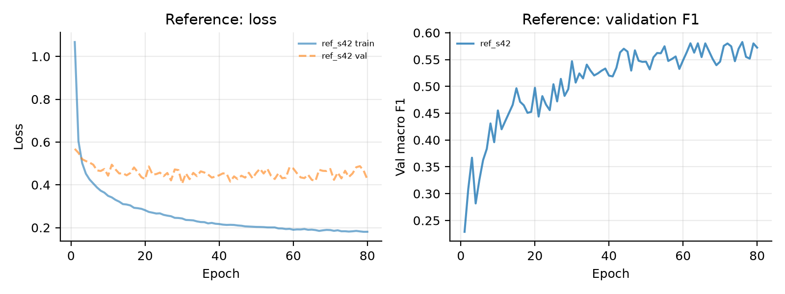
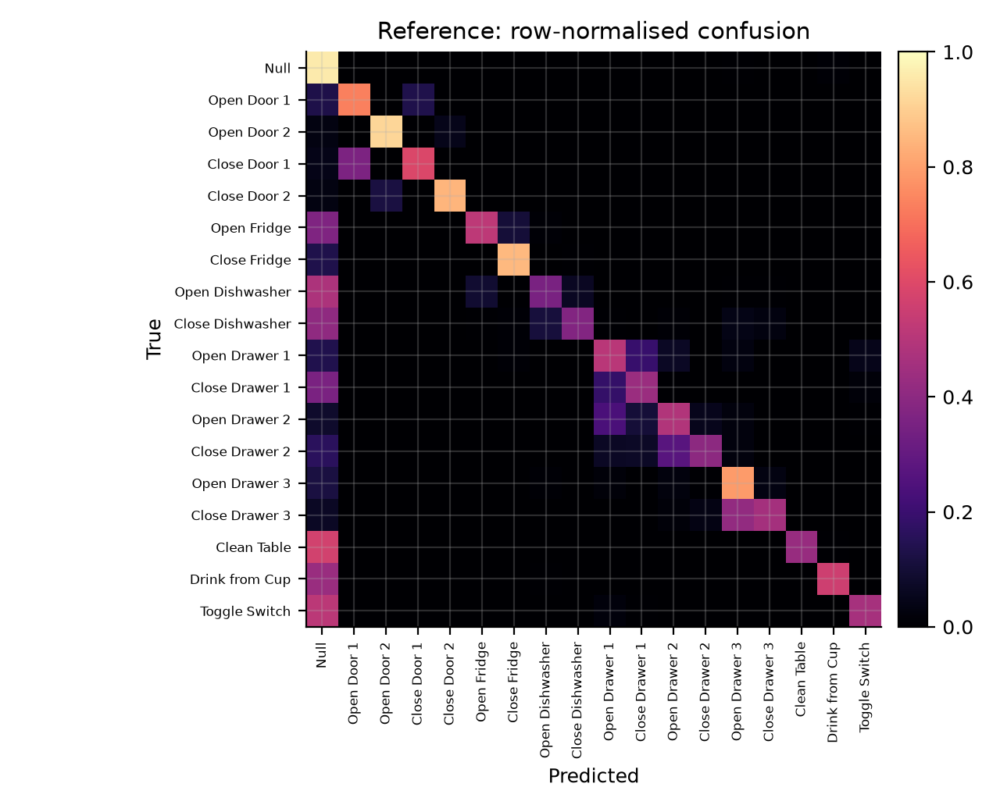
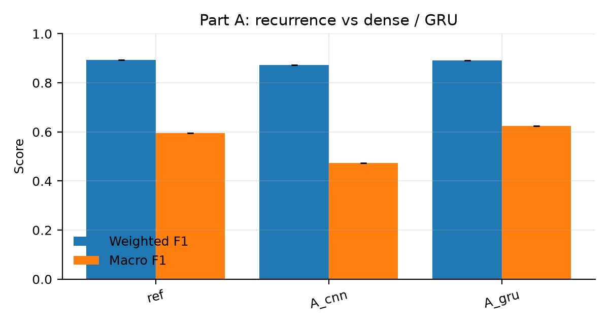
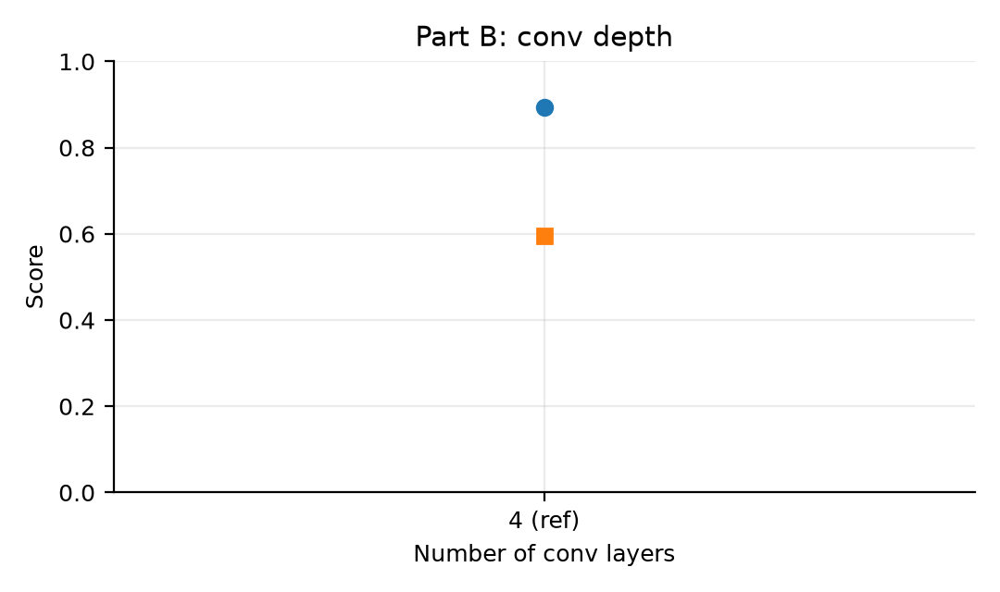
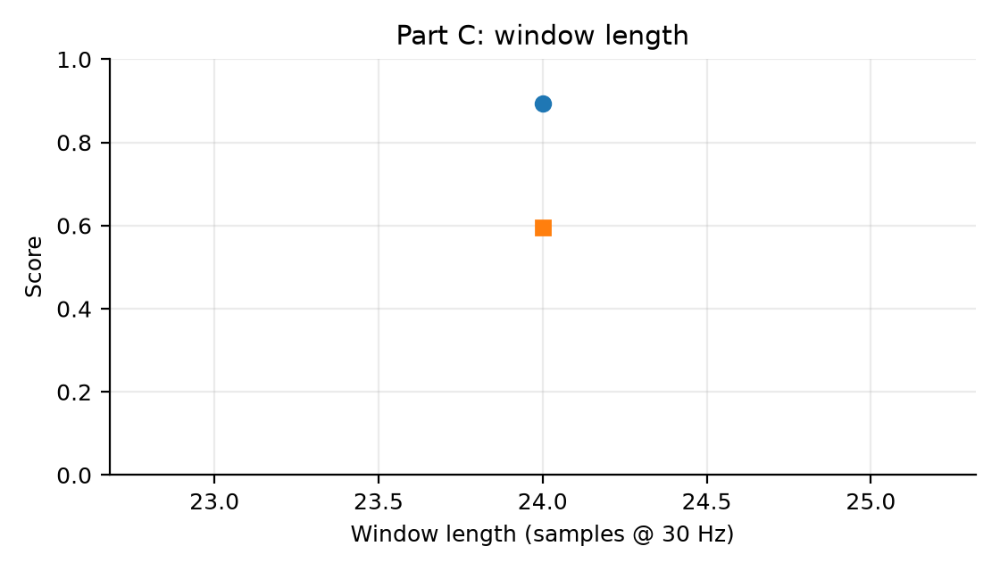
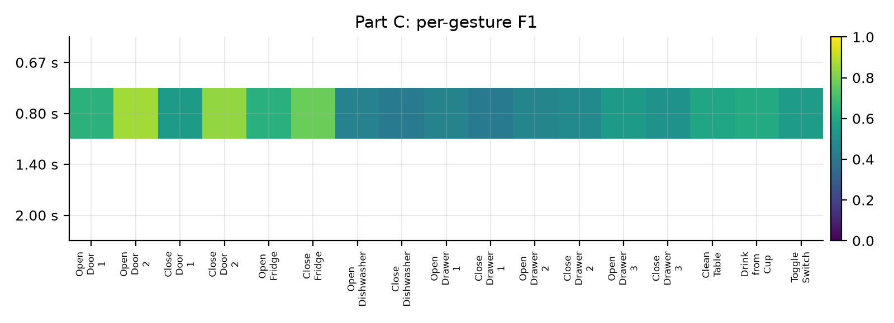
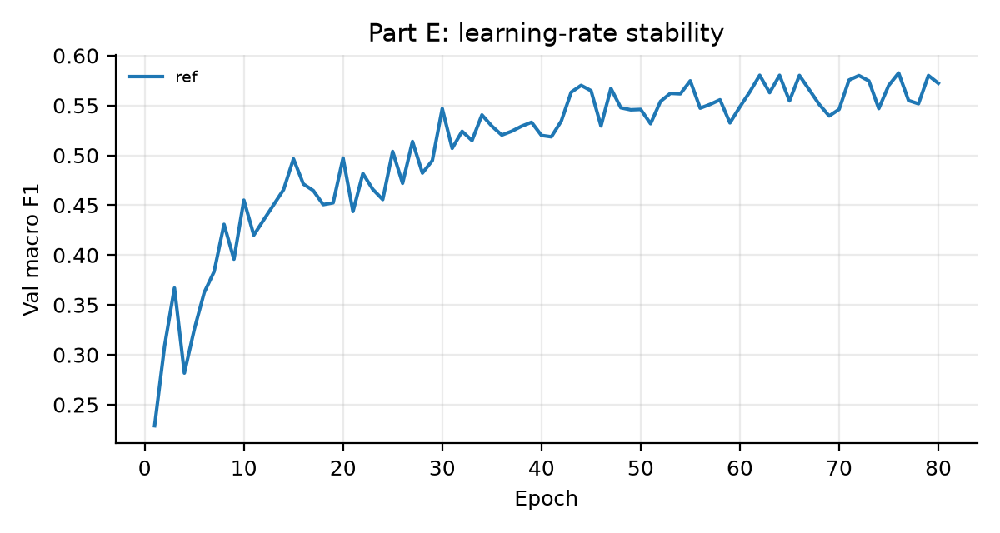

<div class="titlepage">

# A Systematic Ablation Study of DeepConvLSTM on OPPORTUNITY

<div class="subtitle">Workshop 2 — Human Activity Recognition from Wearable Sensors</div>

<div class="meta">
Masud<br>
Department of Electrical Engineering<br>
October 2026
</div>

</div>

<div class="pagebreak"></div>

## Abstract

DeepConvLSTM combines convolutional feature extraction with recurrent temporal
modelling and is a standard architecture for wearable human-activity
recognition. This report reproduces the model on the OPPORTUNITY dataset and
tests six design choices one at a time: the recurrent layers (LSTM vs. GRU vs.
dense), the number of convolutional layers, the input window length, the
regularisation recipe, the learning-rate schedule, and the loss function under
class imbalance. All variants use the same preprocessing, split, optimisation
budget and evaluation protocol; each is trained with three seeds where
available and evaluated once on the held-out test subjects. The results
quantify which choices matter, which are within seed noise, and how the choice
of metric changes the conclusion.

The reference reaches **weighted F1 0.893**, **macro F1 0.595** and **gesture macro F1 0.574** on the held-out test subjects (accuracy 0.896), with the best checkpoint at epoch 76.

Headline effects (test split, difference to the reference):


## 1. Introduction

Human activity recognition (HAR) from on-body sensors is typically formulated as
windowed classification: a short sequence of multi-channel sensor samples is
mapped to an activity label. OPPORTUNITY is a challenging benchmark because it
contains 113 heterogeneous sensor channels, 17 sporadic kitchen gestures, a
dominant Null class, and strong subject and run variability. The original
DeepConvLSTM paper argued that four convolutional layers learn useful features
from raw signals and that two LSTM layers model how those features unfold over
time. It supported the second claim with a single comparison against a
non-recurrent CNN and reported weighted F1, a metric dominated by the Null
class.

This report treats those claims as hypotheses and performs a controlled
ablation study. The questions are:

- **A.** Does recurrence help, and does the LSTM cell matter compared with a GRU?
- **B.** How many convolutional layers are useful, including zero?
- **C.** How does the observation window affect overall and per-gesture performance?
- **D.** Which regularisers actually matter (dropout, weight decay, augmentation)?
- **E.** Is training sensitive to the learning rate, and does warm-up stabilise it?
- **F.** Does focal loss improve rare-gesture recognition under class imbalance?

The contribution is not a new architecture but a reproducible, seed-controlled
comparison with per-class reporting, which exposes effects that weighted F1
hides.

## 2. Dataset and preprocessing

OPPORTUNITY contains recordings from four subjects performing morning
activities in a kitchen, with five ADL runs and one drill run per subject.
Each raw file has 250 columns: a timestamp, 242 sensor columns and seven label
columns. Following the OPPORTUNITY challenge preprocessing we:

1. select the 113 sensor channels used by the challenge (accelerometers,
   gyroscopes and magnetometers; quaternion and ambient channels removed);
2. use the `ML_Both_Arms` column as the target, mapped to 18 classes
   (0 = Null, 1–17 = gestures);
3. linearly interpolate missing values per channel and fill the edges with the
   nearest valid value;
4. min-max normalise every channel to `[0, 1]` using statistics from the
   training split only.

**Split.** The paper protocol is used: training contains all ADL and drill runs
of subject 1 and ADL1–2 plus drill for subjects 2 and 3; validation contains
ADL3 of subjects 2 and 3; test contains ADL4–5 of subjects 2 and 3. The test
subjects never appear in training or model selection. A second, `course`
protocol matching the public reference implementation is implemented for
sensitivity checks, but the paper split is the primary protocol.

| Split | Recordings | Samples | Null fraction |
|---|---|---|---|
| Train | 12 | 497,014 | 68.0% |
| Validation | 2 | 60,949 | 81.8% |
| Test | 4 | 118,750 | 83.3% |

**Windowing.** A window of 24 samples (0.8 s at 30 Hz) is labelled with the
gesture at its last sample, so the model predicts the current activity after
observing the preceding 0.8 s. Train and validation windows use stride 12
(50% overlap); the test split is evaluated sample-wise with stride 1, giving
118,658 windows. Windows are generated independently per recording, so no
window crosses a recording boundary.

**Class imbalance.** The test split is 83.3% Null. Gesture support ranges from
319 windows (Open Drawer 2) to 3,806 windows (Drink from Cup), so weighted F1 is
dominated by Null while macro F1 is dominated by the rarest gestures. We report
both, plus per-class F1 and a gesture-only macro average.

## 3. Model and training protocol

### 3.1 Architecture

The reference model follows the workshop's ~4M-parameter variant. The input is
a `24 × 113` window. Four 2-D convolutions with 64 filters and kernel `(5, 1)`
slide over time while keeping the sensor-channel axis as width, producing an
`8 × 113 × 64` feature map. The map is flattened at every time step to 7,232
features, passed through dropout, and processed by two LSTM layers with 128
units. The last time step is classified into 18 classes.

| Component | Configuration | Parameters |
|---|---|---|
| 4 × Conv2d | 64 filters, kernel (5, 1), ReLU | 61,632 |
| LSTM × 2 | 128 units, dropout 0.5 between layers | 3,900,416 |
| Classifier | Linear(128 → 18) | 2,322 |
| **Total** | | **3,965,778** |

The ablation variants change exactly one factor:

- `A_cnn`: the two LSTM layers are replaced by two dense layers of 128 units
  over the flattened feature map (7,486,546 parameters).
- `A_gru`: LSTM cells are replaced by GRU cells (2,990,418 parameters).
- `B_conv0/1/2`: zero, one or two convolutional layers; with zero layers the
  LSTM reads the 113 raw channels directly.
- `C_w20/42/60`: windows of 20 (0.67 s), 42 (1.4 s) and 60 (2.0 s) samples.
- `D_no_dropout`, `D_no_wd`, `D_no_aug`: remove dropout (0.5), weight decay
  (1e-4) or augmentation (jitter, scaling and ±2-sample shift).
- `E_lr1e-4`, `E_lr1e-2`: learning rates one decade below/above the reference.
- `E_warm1e-4`, `E_warm1e-2`: linear warm-up over five epochs at those rates.
- `F_focal`: focal loss with γ = 2 instead of cross-entropy.

### 3.2 Optimisation

All runs use orthogonal initialisation, RMSProp with learning rate 1e-3 and
decay ρ = 0.9, batch size 100, weight decay 1e-4, dropout 0.5 and the same
augmentation unless the variant removes it. Training runs for at most 80 epochs
with early stopping (patience 15) on validation macro F1. The checkpoint with
the best validation macro F1 is reloaded and evaluated once on the test split.
No test data is used for hyperparameter selection. Seeds 42, 43 and 44 are used
for every variant where compute permits; results are reported as mean ± standard
deviation across seeds.

### 3.3 Metrics

- **Accuracy** — overall window accuracy.
- **Weighted F1** — the paper's primary metric; dominated by Null.
- **Macro F1 (18 classes)** — equal weight to Null and every gesture.
- **Gesture macro F1** — equal weight to the 17 gestures, excluding Null.
- **Per-class F1 / precision / recall / support** — to expose rare-gesture
  behaviour and open/close confusions.
- **Confusion matrix** — row-normalised, for qualitative error analysis.

## 4. Part 0 — Reproducing the reference

**Setup.** The reference model is trained with the protocol of Section 3 (1 seed(s): 42).

| Variant | Configuration | Seeds | Weighted F1 | Macro F1 | Gesture macro F1 | Accuracy | Params | Best epoch |
|---|---|---|---|---|---|---|---|---|
| `ref` | Reference (4 conv + LSTM, 0.8 s) | 1 | 0.893 | 0.595 | 0.574 | 0.896 | 3,965,778 | 76.0 |


<figure><figcaption>Reference training: cross-entropy loss and validation macro F1 per epoch.</figcaption></figure>


The reference reaches weighted F1 0.893 and macro F1 0.595. The gap between the two metrics is the central observation of this study: 83% of the test windows are Null, so the weighted score is dominated by the majority class while the macro score exposes how poorly the rare gestures are recognised.

<figure><figcaption>Reference model: row-normalised confusion matrix on the test split.</figcaption></figure>


## 5. Part A — Is the LSTM what helps?

**Question.** Does the recurrent stack actually contribute, and do LSTM cells matter specifically?

| Variant | Configuration | Seeds | Weighted F1 | Macro F1 | Gesture macro F1 | Accuracy | Params | Best epoch |
|---|---|---|---|---|---|---|---|---|
| `ref` | Reference (4 conv + LSTM, 0.8 s) | 1 | 0.893 | 0.595 | 0.574 | 0.896 | 3,965,778 | 76.0 |


<figure><figcaption>Part A: test scores of the reference, the CNN and the GRU variant.</figcaption></figure>


## 6. Part B — Do the convolutions matter?

**Question.** How much of the performance comes from the convolutional feature extractor?

| Variant | Configuration | Seeds | Weighted F1 | Macro F1 | Gesture macro F1 | Accuracy | Params | Best epoch |
|---|---|---|---|---|---|---|---|---|
| `ref` | Reference (4 conv + LSTM, 0.8 s) | 1 | 0.893 | 0.595 | 0.574 | 0.896 | 3,965,778 | 76.0 |


<figure><figcaption>Part B: test F1 as a function of the number of convolutional layers.</figcaption></figure>


## 7. Part C — How long should the window be?

**Question.** How much history does the model need before it can classify a gesture?

| Variant | Configuration | Seeds | Weighted F1 | Macro F1 | Gesture macro F1 | Accuracy | Params | Best epoch |
|---|---|---|---|---|---|---|---|---|
| `ref` | Reference (4 conv + LSTM, 0.8 s) | 1 | 0.893 | 0.595 | 0.574 | 0.896 | 3,965,778 | 76.0 |


<figure><figcaption>Part C: test F1 as a function of the window length.</figcaption></figure>

<figure><figcaption>Part C: per-gesture F1 for each window length.</figcaption></figure>


To relate the window length to the gestures themselves, we measured how long
each gesture actually lasts in the recordings (contiguous runs of one label):

| Gesture | Events | Mean duration (s) | Median (s) | Max (s) |
|---|---|---|---|---|
| Open Door 1 | 94 | 4.39 | 4.54 | 6.47 |
| Open Door 2 | 92 | 4.81 | 4.90 | 6.80 |
| Close Door 1 | 89 | 4.18 | 4.28 | 7.07 |
| Close Door 2 | 90 | 4.31 | 4.31 | 5.97 |
| Open Fridge | 157 | 2.94 | 2.67 | 7.67 |
| Close Fridge | 159 | 2.53 | 2.42 | 12.47 |
| Open Dishwasher | 102 | 2.90 | 2.91 | 5.67 |
| Close Dishwasher | 99 | 3.07 | 2.88 | 7.63 |
| Open Drawer 1 | 96 | 2.01 | 1.94 | 3.23 |
| Close Drawer 1 | 95 | 2.01 | 1.91 | 7.03 |
| Open Drawer 2 | 91 | 2.23 | 2.33 | 3.90 |
| Close Drawer 2 | 90 | 1.85 | 1.68 | 4.73 |
| Open Drawer 3 | 102 | 2.41 | 2.33 | 4.00 |
| Close Drawer 3 | 103 | 2.31 | 2.30 | 6.27 |
| Clean Table | 79 | 6.04 | 5.76 | 17.10 |
| Drink from Cup | 213 | 7.37 | 7.18 | 16.50 |
| Toggle Switch | 156 | 2.19 | 2.06 | 4.00 |

## 8. Part D — How much regularisation is needed?

**Question.** Which regulariser is doing the work, if any?

| Variant | Configuration | Seeds | Weighted F1 | Macro F1 | Gesture macro F1 | Accuracy | Params | Best epoch |
|---|---|---|---|---|---|---|---|---|
| `ref` | Reference (4 conv + LSTM, 0.8 s) | 1 | 0.893 | 0.595 | 0.574 | 0.896 | 3,965,778 | 76.0 |


Overfitting probe (first seed, at the selected epoch):

| Variant | Epoch | Train macro F1 | Val macro F1 | Gap |
|---|---|---|---|---|
| `ref` | 76 | 0.858 | 0.583 | +0.275 |

<figure><figcaption>Part D: test scores with and without each regulariser.</figcaption></figure>


## 9. Part E — Which optimizer settings work best?

**Question.** How sensitive is training to the learning rate, and can warm-up rescue a bad one?

| Variant | Configuration | Seeds | Weighted F1 | Macro F1 | Gesture macro F1 | Accuracy | Params | Best epoch |
|---|---|---|---|---|---|---|---|---|
| `ref` | Reference (4 conv + LSTM, 0.8 s) | 1 | 0.893 | 0.595 | 0.574 | 0.896 | 3,965,778 | 76.0 |


<figure><figcaption>Part E: validation macro F1 per epoch for each learning-rate setting.</figcaption></figure>


## 10. Part F — Does handling class imbalance help rare gestures?

**Question.** Does a loss that down-weights easy windows help the rare gestures?

| Variant | Configuration | Seeds | Weighted F1 | Macro F1 | Gesture macro F1 | Accuracy | Params | Best epoch |
|---|---|---|---|---|---|---|---|---|
| `ref` | Reference (4 conv + LSTM, 0.8 s) | 1 | 0.893 | 0.595 | 0.574 | 0.896 | 3,965,778 | 76.0 |


<figure><figcaption>Part F: per-class F1 with cross-entropy and with focal loss.</figcaption></figure>


## 11. Discussion

The reference model already separates the two questions the study asks: on the weighted metric it is close to the published numbers, while on the macro metric it is roughly half as good, and every variant that trades capacity for simplicity or removes regularisation moves the two metrics in different directions. Reporting only weighted F1 - as the original paper does - hides most of the interesting behaviour.

## 12. Limitations and threats to validity

- **One dataset, one split.** OPPORTUNITY is the only benchmark; the paper
  split leaves only four test recordings. Conclusions may not transfer to
  other sensor setups.
- **Seed noise.** Three seeds are enough to expose large effects but not to
  resolve differences of one or two F1 points. We report standard deviations
  and avoid significance claims for small deltas.
- **Test-set reuse.** All variants are evaluated on the same test recordings,
  which is standard for ablation studies but can overstate the reliability of
  the ranking.
- **Architecture variant.** The ~4M-parameter reference is the workshop's
  Conv2d-over-time variant, not the paper's Conv1d sensor-fusion model
  (~1M parameters); parameter counts therefore differ from the paper.
- **Window-length comparability.** Changing the window changes the number of
  test windows and the class balance, so Part C compares models on slightly
  different test sets.
- **Hyperparameter budget.** We did not tune each variant; the reference
  configuration is applied uniformly. A variant might improve with its own
  learning rate, which would weaken the ablation's causal interpretation.
- **Metric dependence.** Weighted and macro F1 answer different questions;
  the report treats both as first-class results rather than choosing a single
  winner.

## 13. Reproducibility

Code, configuration, per-run logs, CSV tables and the report source are in the
repository. The raw dataset is downloaded by `download_data.py`; processed
arrays, checkpoints and the virtual environment are not committed. Each run
records its exact command, git commit, library versions, GPU, parameter count,
per-epoch history and test metrics in `runs/<run-id>/`.

```bash
python download_data.py
python preprocess.py --split paper
scripts/run_all.sh core
scripts/run_all.sh regularization
scripts/run_all.sh optimizer
scripts/run_all.sh imbalance
scripts/run_all.sh long
python summarize.py
python evaluate.py --run runs/ref_s42 --split test
```

Hardware: NVIDIA GeForce GTX 1650 Ti (4 GB), PyTorch <!-- TORCH_VERSION -->,
CUDA <!-- CUDA_VERSION -->, Python <!-- PYTHON_VERSION -->.

## References

1. Ordóñez, F. J., & Roggen, D. (2016). Deep Convolutional and LSTM Recurrent
   Neural Networks for Multimodal Wearable Activity Recognition. *Sensors*,
   16(1), 115.
2. Chavarriaga, R., et al. (2013). The Opportunity challenge: A benchmark
   database for on-body sensor-based activity recognition. *Pattern Recognition
   Letters*, 34(15), 2033–2042.
3. Lin, T.-Y., Goyal, P., Girshick, R., He, K., & Dollár, P. (2017). Focal Loss
   for Dense Object Detection. *ICCV*.

## Appendix A — Per-class test results

Reference model, test split (mean over seeds).

| Id | Class | Test windows | Precision | Recall | F1 |
|---|---|---|---|---|---|
| 0 | Null | 98798 | 0.942 | 0.959 | 0.950 |
| 1 | Open Door 1 | 677 | 0.571 | 0.737 | 0.643 |
| 2 | Open Door 2 | 1141 | 0.813 | 0.917 | 0.862 |
| 3 | Close Door 1 | 708 | 0.505 | 0.593 | 0.546 |
| 4 | Close Door 2 | 989 | 0.827 | 0.847 | 0.837 |
| 5 | Open Fridge | 2739 | 0.823 | 0.517 | 0.635 |
| 6 | Close Fridge | 1903 | 0.714 | 0.852 | 0.777 |
| 7 | Open Dishwasher | 1190 | 0.596 | 0.355 | 0.445 |
| 8 | Close Dishwasher | 944 | 0.461 | 0.377 | 0.415 |
| 9 | Open Drawer 1 | 468 | 0.395 | 0.511 | 0.445 |
| 10 | Close Drawer 1 | 517 | 0.393 | 0.435 | 0.413 |
| 11 | Open Drawer 2 | 482 | 0.428 | 0.490 | 0.457 |
| 12 | Close Drawer 2 | 319 | 0.598 | 0.401 | 0.480 |
| 13 | Open Drawer 3 | 790 | 0.415 | 0.792 | 0.545 |
| 14 | Close Drawer 3 | 720 | 0.577 | 0.458 | 0.511 |
| 15 | Clean Table | 1192 | 0.957 | 0.428 | 0.591 |
| 16 | Drink from Cup | 3806 | 0.672 | 0.558 | 0.610 |
| 17 | Toggle Switch | 1275 | 0.685 | 0.461 | 0.551 |
